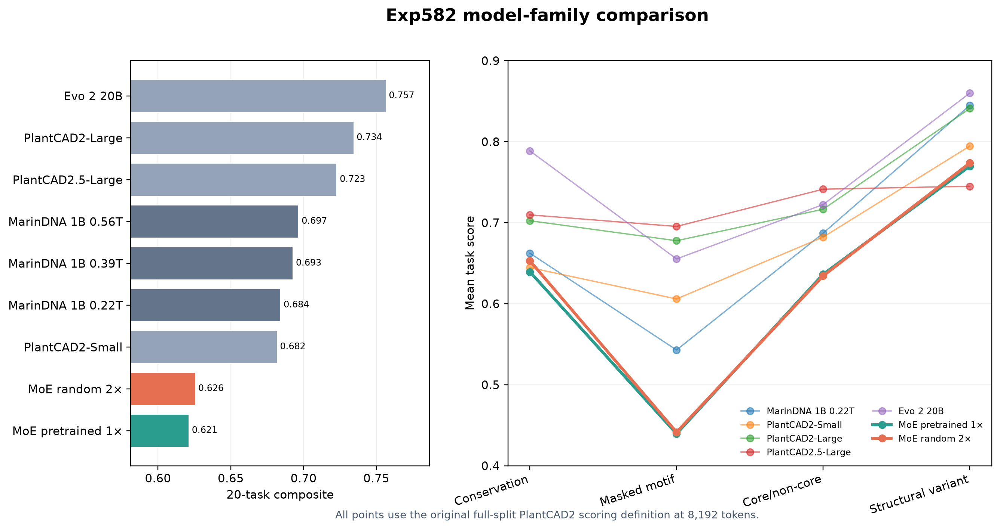
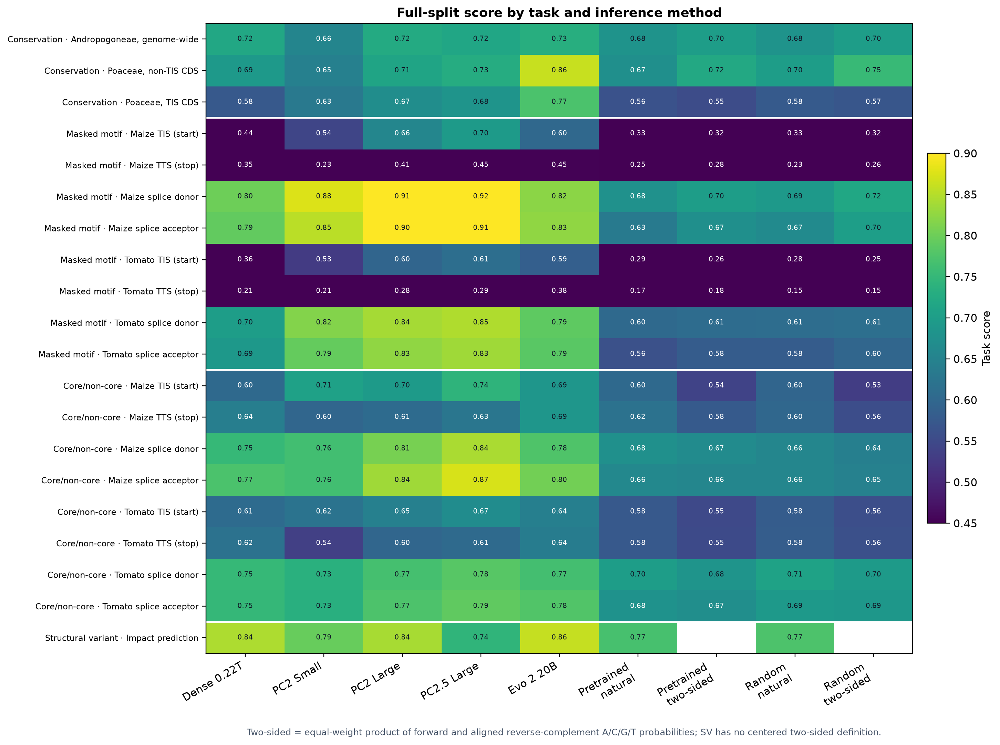
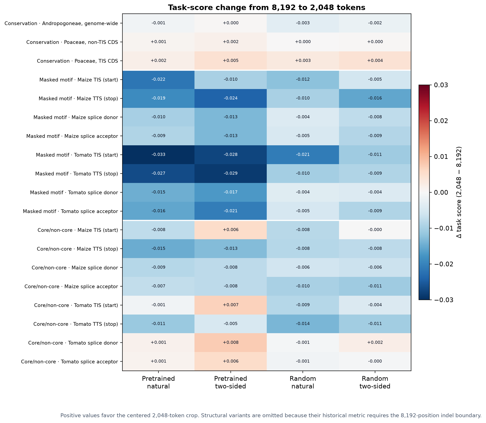
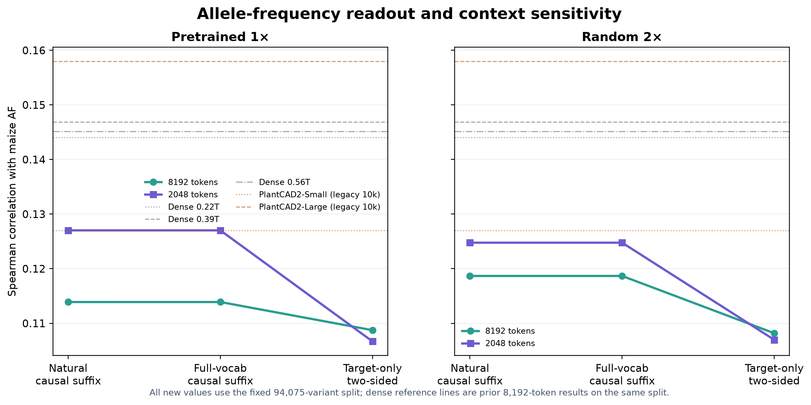
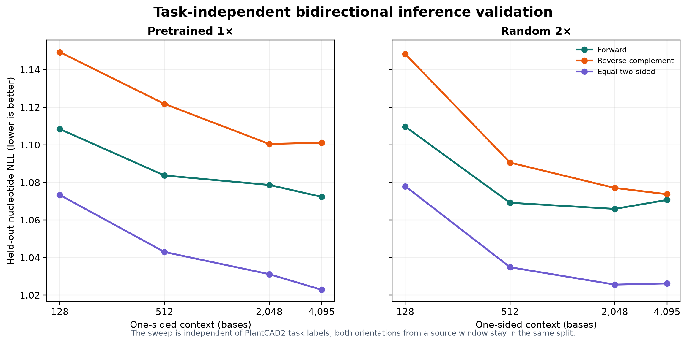
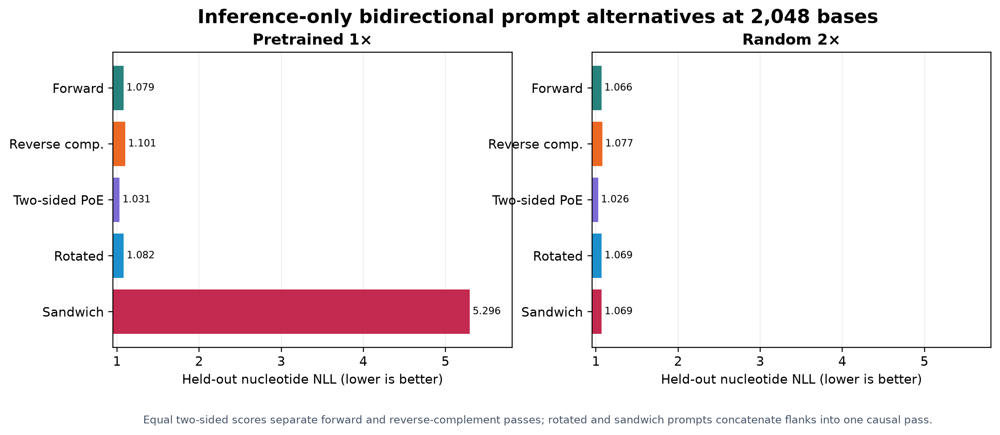

# exp582 final task and zero-shot AF results

These are full-split evaluations of the final step-21,440 checkpoints for the selected d1536 MoE trials: pretrained 1× and random 2×. Both saw 11.24B DNA tokens, about 0.52 corpus passes; the dense references are archived exp472 results and were not rerun.

- The random model is slightly ahead on the original 8K natural composite: **0.6256 vs 0.6213**. Both trail dense 0.22T (0.6843), with masked motifs the largest gap.
- Equal-weight forward/reverse-complement PoE improves the three-group composite by **+0.0021** pretrained and **+0.0026** random. It helps conservation and motifs but consistently hurts core/non-core classification, so it is useful as a task-dependent readout rather than a universal replacement.
- Centering a 2K crop hurts the three-group task composite but improves natural AF Spearman from **0.1139 to 0.1270** pretrained and **0.1187 to 0.1248** random.
- Separate forward and reverse-complement passes are the strongest task-independent bidirectional method tested. Rotated and sandwich single-pass prompts do not improve held-out nucleotide likelihood; the pretrained sandwich prompt fails badly.

> Frozen-embedding probe fitting is intentionally deferred. The complete embeddings remain in durable storage, so fitting them later will not require another model-inference pass.

## Full task results and inference methods

The natural score retains the PR20 rule: choose the better completed forward or reverse-complement task-level metric for each non-SV task. Two-sided PoE multiplies aligned A/C/G/T probabilities from separate forward and reverse-complement passes with equal weight; SV has no centered two-sided definition.

<strong>Group scores and historical comparison</strong>

| Model | Conservation | Masked motif | Core/non-core | SV | Composite |
| :--- | ---: | ---: | ---: | ---: | ---: |
| MoE random 2× | 0.6530 | 0.4414 | 0.6344 | 0.7737 | 0.6256 |
| MoE pretrained 1× | 0.6394 | 0.4395 | 0.6363 | 0.7698 | 0.6213 |
| MarinDNA 1B 0.22T | 0.6624 | 0.5428 | 0.6871 | 0.8448 | 0.6843 |
| MarinDNA 1B 0.39T | 0.6679 | 0.5613 | 0.6921 | 0.8497 | 0.6927 |
| MarinDNA 1B 0.56T | 0.6693 | 0.5696 | 0.6951 | 0.8526 | 0.6966 |
| PlantCAD2-Small | 0.6445 | 0.6059 | 0.6823 | 0.7946 | 0.6818 |
| PlantCAD2-Large | 0.7024 | 0.6777 | 0.7166 | 0.8410 | 0.7344 |
| PlantCAD2.5-Large | 0.7097 | 0.6954 | 0.7414 | 0.7450 | 0.7229 |
| Evo 2 20B | 0.7887 | 0.6552 | 0.7224 | 0.8600 | 0.7566 |

All values use the full splits and 8,192-position inputs. Composite gives each of the four task groups equal weight.

<strong>Matched three-group natural and two-sided scores</strong>

| Condition / context / method | Conservation | Masked motif | Core/non-core | 3-group composite |
| :--- | ---: | ---: | ---: | ---: |
| Pretrained 1× · 8192 · natural | 0.6394 | 0.4395 | 0.6363 | 0.5717 |
| Pretrained 1× · 8192 · two-sided PoE | 0.6588 | 0.4503 | 0.6123 | 0.5738 |
| Pretrained 1× · 2048 · natural | 0.6399 | 0.4207 | 0.6303 | 0.5636 |
| Pretrained 1× · 2048 · two-sided PoE | 0.6610 | 0.4310 | 0.6113 | 0.5677 |
| Random 2× · 8192 · natural | 0.6530 | 0.4414 | 0.6344 | 0.5762 |
| Random 2× · 8192 · two-sided PoE | 0.6747 | 0.4515 | 0.6103 | 0.5788 |
| Random 2× · 2048 · natural | 0.6529 | 0.4325 | 0.6273 | 0.5709 |
| Random 2× · 2048 · two-sided PoE | 0.6756 | 0.4428 | 0.6055 | 0.5746 |

The three-group composite excludes SV from both methods so the comparison is matched.

<strong>All 20 task rows</strong>

| Task | n | Metric | Pretrained natural | Pretrained PoE | Random natural | Random PoE | Dense .22T | PC2 Small | PC2 Large | PC2.5 Large | Evo 2 20B |
| :--- | ---: | :--- | ---: | ---: | ---: | ---: | ---: | ---: | ---: | ---: | ---: |
| Conservation · Andropogoneae, genome-wide | 38,060 | AUROC | 0.6816 | 0.7000 | 0.6813 | 0.7004 | 0.7201 | 0.6555 | 0.7245 | 0.7170 | 0.7320 |
| Conservation · Poaceae, non-TIS CDS | 183,685 | AUROC | 0.6735 | 0.7213 | 0.6996 | 0.7538 | 0.6915 | 0.6462 | 0.7125 | 0.7290 | 0.8620 |
| Conservation · Poaceae, TIS CDS | 36,662 | AUROC | 0.5632 | 0.5550 | 0.5779 | 0.5699 | 0.5754 | 0.6319 | 0.6703 | 0.6830 | 0.7720 |
| Masked motif · Maize TIS (start) | 39,035 | Accuracy | 0.3327 | 0.3232 | 0.3259 | 0.3213 | 0.4364 | 0.5449 | 0.6571 | 0.6960 | 0.6020 |
| Masked motif · Maize TTS (stop) | 39,035 | Accuracy | 0.2463 | 0.2768 | 0.2266 | 0.2566 | 0.3504 | 0.2302 | 0.4096 | 0.4460 | 0.4530 |
| Masked motif · Maize splice donor | 153,869 | Accuracy | 0.6776 | 0.7010 | 0.6913 | 0.7173 | 0.8011 | 0.8754 | 0.9104 | 0.9210 | 0.8220 |
| Masked motif · Maize splice acceptor | 153,869 | Accuracy | 0.6346 | 0.6739 | 0.6659 | 0.7026 | 0.7920 | 0.8537 | 0.8996 | 0.9130 | 0.8260 |
| Masked motif · Tomato TIS (start) | 35,484 | Accuracy | 0.2875 | 0.2597 | 0.2838 | 0.2491 | 0.3641 | 0.5274 | 0.5960 | 0.6120 | 0.5860 |
| Masked motif · Tomato TTS (stop) | 35,483 | Accuracy | 0.1700 | 0.1783 | 0.1467 | 0.1520 | 0.2085 | 0.2051 | 0.2848 | 0.2940 | 0.3790 |
| Masked motif · Tomato splice donor | 140,456 | Accuracy | 0.6046 | 0.6085 | 0.6104 | 0.6142 | 0.7006 | 0.8165 | 0.8387 | 0.8460 | 0.7890 |
| Masked motif · Tomato splice acceptor | 140,455 | Accuracy | 0.5624 | 0.5813 | 0.5808 | 0.5989 | 0.6895 | 0.7940 | 0.8257 | 0.8350 | 0.7850 |
| Core/non-core · Maize TIS (start) | 36,409 | AUROC | 0.6034 | 0.5399 | 0.5971 | 0.5325 | 0.6040 | 0.7070 | 0.6960 | 0.7430 | 0.6860 |
| Core/non-core · Maize TTS (stop) | 36,409 | AUROC | 0.6196 | 0.5778 | 0.6000 | 0.5556 | 0.6419 | 0.5980 | 0.6080 | 0.6260 | 0.6860 |
| Core/non-core · Maize splice donor | 144,550 | AUROC | 0.6752 | 0.6673 | 0.6561 | 0.6450 | 0.7507 | 0.7640 | 0.8080 | 0.8420 | 0.7760 |
| Core/non-core · Maize splice acceptor | 144,550 | AUROC | 0.6606 | 0.6560 | 0.6568 | 0.6470 | 0.7727 | 0.7630 | 0.8360 | 0.8730 | 0.8040 |
| Core/non-core · Tomato TIS (start) | 35,478 | AUROC | 0.5755 | 0.5488 | 0.5814 | 0.5577 | 0.6068 | 0.6220 | 0.6460 | 0.6680 | 0.6440 |
| Core/non-core · Tomato TTS (stop) | 35,477 | AUROC | 0.5763 | 0.5518 | 0.5821 | 0.5606 | 0.6195 | 0.5350 | 0.5980 | 0.6060 | 0.6390 |
| Core/non-core · Tomato splice donor | 140,451 | AUROC | 0.7009 | 0.6836 | 0.7091 | 0.6955 | 0.7514 | 0.7350 | 0.7670 | 0.7830 | 0.7660 |
| Core/non-core · Tomato splice acceptor | 140,451 | AUROC | 0.6792 | 0.6729 | 0.6925 | 0.6886 | 0.7495 | 0.7340 | 0.7740 | 0.7900 | 0.7780 |
| Structural variant · Impact prediction | 18,075 | AUPRC | 0.7698 | — | 0.7737 | — | 0.8448 | 0.7946 | 0.8410 | 0.7450 | 0.8600 |

## Context length

The 2K centered crop preserves conservation but usually reduces masked-motif and core/non-core scores. It remains useful for AF, where prior dense experiments also found an optimum near 2K.

## Maize allele frequency

<strong>AF correlations on the fixed 94,075-variant split</strong>

| Model / context | Readout | Pearson | Spearman |
| :--- | :--- | ---: | ---: |
| MoE pretrained 1× · 8192 | natural causal suffix | 0.12493 | 0.11390 |
| MoE pretrained 1× · 8192 | full-vocabulary causal suffix | 0.12493 | 0.11390 |
| MoE pretrained 1× · 8192 | target-only two-sided PoE | 0.14868 | 0.10874 |
| MoE pretrained 1× · 2048 | natural causal suffix | 0.12726 | 0.12702 |
| MoE pretrained 1× · 2048 | full-vocabulary causal suffix | 0.12726 | 0.12702 |
| MoE pretrained 1× · 2048 | target-only two-sided PoE | 0.14603 | 0.10668 |
| MoE random 2× · 8192 | natural causal suffix | 0.13320 | 0.11867 |
| MoE random 2× · 8192 | full-vocabulary causal suffix | 0.13320 | 0.11867 |
| MoE random 2× · 8192 | target-only two-sided PoE | 0.14681 | 0.10818 |
| MoE random 2× · 2048 | natural causal suffix | 0.13700 | 0.12477 |
| MoE random 2× · 2048 | full-vocabulary causal suffix | 0.13700 | 0.12477 |
| MoE random 2× · 2048 | target-only two-sided PoE | 0.14522 | 0.10698 |
| MarinDNA 1B 0.22T · 8192 | natural causal suffix | 0.13635 | 0.14401 |
| MarinDNA 1B 0.39T · 8192 | natural causal suffix | 0.13802 | 0.14690 |
| MarinDNA 1B 0.56T · 8192 | natural causal suffix | 0.13696 | 0.14517 |
| PlantCAD2-Small · 8192 | published legacy 10k | 0.16400 | 0.12700 |
| PlantCAD2-Large · 8192 | published legacy 10k | 0.20200 | 0.15800 |

The PlantCAD2 AF rows use the older 10k sample and are shown only as historical context. No comparable PlantCAD2.5 or Evo AF result is available.

## Task-independent bidirectional method validation

The method selection used 256 source windows with both orientations kept in the same split and no PlantCAD2 task labels. Equal two-sided PoE lowers held-out nucleotide NLL for both models at every tested context. A calibrated directional weight looked better on the calibration split but lost to equal weighting on held-out positions, so the full evaluation uses the task-independent equal-weight rule.

<strong>Execution, checkpoints, and verification</strong>

- Architecture: d1536 MoE, 11.5B total / 481M active parameters, 16 layers, 384 experts, 8 routed experts/token, 2 shared experts, 8,192-token maximum context.
- Training exposure: 21,440 updates, 11,240,734,720 one-character DNA tokens, about 0.52 corpus passes. Pretrained uses the retained 128,256-entry language vocabulary with character-bound tokenization; random uses the 8-entry DNA vocabulary.
- Final checkpoints: pretrained `step-21440` metadata `c882f2…fa4d6`; random `step-21440` metadata `4a1ddb…c347`.
- Evaluation: 16 one-node H100x8 workers per model at Iris batch priority under `eczech`; 3,185 independently committed chunks per model and 6,370 total.
- Coverage: 1,727,943 rows across all 20 tasks at 8K; 19 centered tasks at 2K; 94,075 AF variants at each context; complete row order, chunk checksums, checkpoint/tokenizer/input bindings, runtime oracles, and Sonic backend identity verified independently for every worker.
- Reduction receipts: pretrained `68c7049c583effb5061c71027ae40bb8a56d7c78edadec045a318d4e0b0a5aad`; random `2395d77f5928494fbb4597d1c76ffa389e679336a77790b4fa80cabd419848ee`. Every stored file was rehashed; AF membership, finiteness, and every overall/by-consequence Pearson and Spearman value were independently recomputed.
- The initial CPU reducer was launched on all eight local ranks. One rank committed each complete receipt; a peer then rejected its different temporary-path string in `result.json`. The scientific artifacts above passed independent validation, and MarinDNA commit `916e03d` makes future postprocessing single-writer.
- [Pretrained training run](https://wandb.ai/eric-czech/marin/runs/exp582-plantcad2-d1536-pretrained-lrm1-seed0-v1) · [random training run](https://wandb.ai/eric-czech/marin/runs/exp582-plantcad2-d1536-random-lrm2-seed0-v1) · [pretrained reduction](https://wandb.ai/eric-czech/marin/runs/exp582-plantcad2-d1536-pretrained-lrm1-seed0-final-eval-postprocess-smoke-v1) · [random reduction](https://wandb.ai/eric-czech/marin/runs/exp582-plantcad2-d1536-random-lrm2-seed0-final-eval-postprocess-smoke-v1)

