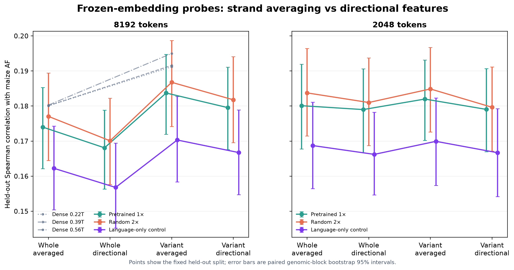

# exp582 final d1536 MoE evaluation

These are full-split evaluations of the final step-21,440 checkpoints for the best completed trial under each initialization condition, plus the original d1536 language checkpoint with **no DNA training** as a negative control. Historical dense, PlantCAD, and Evo values were reused rather than recomputed.

**What 1× and 2× mean:** these are learning-rate multipliers from the six-trial sweep, not model-size or training-budget multipliers. **1×** uses the peak rates predicted by the Hero scaling heuristic: 0.001878 for MuonH parameters and 0.0004334 for Adam parameters. **2×** doubles both peak rates to 0.003756 and 0.0008668. The multiplier changes only those peak rates within each initialization condition; the schedule shape and 11.24B-token budget are the same.

| Model | Total parameters | Active parameters | Prior language tokens | DNA tokens | Approx. total training FLOPs |
| :--- | ---: | ---: | ---: | ---: | ---: |
| MoE pretrained 1× | 11.534B | 481.296M | 380.709B BPE | 11.241B characters | 1.89×10²¹ |
| MoE random 2× | 11.140B | 481.296M | 0 | 11.241B characters | 4.42×10¹⁹ |
| Language-only control | 11.534B | 481.296M | 380.709B BPE | 0 | 1.83×10²¹ |

Active parameters follow the Hero ladder convention: attention, router, top-8 routed experts, latent projections, and shared experts. Pretrained and control retain the 128,256-entry language vocabulary; random uses an eight-token DNA vocabulary. FLOPs are algorithmic forward-plus-backward estimates and exclude communication, optimizer bookkeeping, and rematerialization overhead.


- **DNA training is the decisive difference.** The untouched language model scores **0.3607** on the task composite, versus **0.6213** after DNA adaptation and **0.6256** from random initialization. Language pretraining itself does not improve the selected DNA-trained run.
- **The control is OOD, but it is not numerically collapsed.** Every shard had zero routed-token drops, finite normalized outputs, and varied predictions and hidden states. At 4K, its A/C/G/T-conditional next-base accuracy is near chance (**26.2%**) while NLL is far worse than uniform (**4.34 vs 1.39**), indicating confident errors rather than constant or missing output.
- **For the two DNA-trained models, the best label-free bidirectional task readout is two-sided PoE.** It combines separate forward and reverse-complement predictions. DNA adaptation is still essential: PoE does not rescue the language-only control.
- **For fitted AF probes, average the forward and reverse-complement target-position embeddings.** This is a representation readout rather than probability PoE.
- **The source representation contains some reusable signal.** Its best frozen AF probe reaches **0.1703 Spearman**, below pretrained after DNA adaptation (**0.1837**) and random (**0.1868**), despite its unusable zero-shot task predictions.

## Best bidirectional inference: two-sided PoE

“PoE” means **product of experts**. It runs the same causal model on both DNA orientations so the target receives evidence from each side:

```text
Original:             5′ — left flank — [X] — right flank — 3′
Forward pass:                 left flank ─────▶ Pforward(X)

Reverse complement:   5′ — rc(right) — [rc(X)] — rc(left) — 3′
RC pass:                     right flank ─────▶ PRC(X), after realigning bases

Two-sided result:      P(X) ∝ √(Pforward(X) × PRC(X)), renormalized over A/C/G/T
```

The forward pass sees the original left flank; the reverse-complement pass turns the original right flank into causal context. This costs about two inference passes and requires no retraining or task labels. It is the preferred readout for nucleotide likelihood, conservation, and motif scoring. The historical natural score remains better for core/non-core classification, and structural-variant scoring has no centered two-sided definition.

## Full task results


The natural columns retain the PR20 rule: choose the better completed forward or reverse-complement task-level metric for each non-SV task.

<details>
<summary><strong>Group scores and historical comparison</strong></summary>

| Model | Conservation | Masked motif | Core/non-core | SV | Composite |
| :--- | ---: | ---: | ---: | ---: | ---: |
| MoE random 2× | 0.6530 | 0.4414 | 0.6344 | 0.7737 | 0.6256 |
| MoE pretrained 1× | 0.6394 | 0.4395 | 0.6363 | 0.7698 | 0.6213 |
| Language-only control | 0.5268 | 0.0033 | 0.4939 | 0.4187 | 0.3607 |
| MarinDNA 1B 0.22T | 0.6624 | 0.5428 | 0.6871 | 0.8448 | 0.6843 |
| MarinDNA 1B 0.39T | 0.6679 | 0.5613 | 0.6921 | 0.8497 | 0.6927 |
| MarinDNA 1B 0.56T | 0.6693 | 0.5696 | 0.6951 | 0.8526 | 0.6966 |
| PlantCAD2-Small | 0.6445 | 0.6059 | 0.6823 | 0.7946 | 0.6818 |
| PlantCAD2-Large | 0.7024 | 0.6777 | 0.7166 | 0.8410 | 0.7344 |
| PlantCAD2.5-Large | 0.7097 | 0.6954 | 0.7414 | 0.7450 | 0.7229 |
| Evo 2 20B | 0.7887 | 0.6552 | 0.7224 | 0.8600 | 0.7566 |

All values use the full splits and 8,192-position inputs. Composite gives each of the four task groups equal weight.

</details>

<details>
<summary><strong>Matched three-group natural and two-sided scores</strong></summary>

| Condition / context / method | Conservation | Masked motif | Core/non-core | 3-group composite |
| :--- | ---: | ---: | ---: | ---: |
| Pretrained 1× · 8192 · natural | 0.6394 | 0.4395 | 0.6363 | 0.5717 |
| Pretrained 1× · 8192 · two-sided PoE | 0.6588 | 0.4503 | 0.6123 | 0.5738 |
| Pretrained 1× · 2048 · natural | 0.6399 | 0.4207 | 0.6303 | 0.5636 |
| Pretrained 1× · 2048 · two-sided PoE | 0.6610 | 0.4310 | 0.6113 | 0.5677 |
| Random 2× · 8192 · natural | 0.6530 | 0.4414 | 0.6344 | 0.5762 |
| Random 2× · 8192 · two-sided PoE | 0.6747 | 0.4515 | 0.6103 | 0.5788 |
| Random 2× · 2048 · natural | 0.6529 | 0.4325 | 0.6273 | 0.5709 |
| Random 2× · 2048 · two-sided PoE | 0.6756 | 0.4428 | 0.6055 | 0.5746 |
| Language-only control · 8192 · natural | 0.5268 | 0.0033 | 0.4939 | 0.3413 |
| Language-only control · 8192 · two-sided PoE | 0.4976 | 0.0058 | 0.4677 | 0.3237 |
| Language-only control · 2048 · natural | 0.5257 | 0.0045 | 0.4926 | 0.3409 |
| Language-only control · 2048 · two-sided PoE | 0.4995 | 0.0059 | 0.4660 | 0.3238 |

The three-group composite excludes SV from both methods so the comparison is matched.

</details>

<details>
<summary><strong>All 20 task rows</strong></summary>

| Task | n | Metric | Pretrained natural | Pretrained PoE | Random natural | Random PoE | Language-only natural | Language-only PoE | Dense .22T | PC2 Small | PC2 Large | PC2.5 Large | Evo 2 20B |
| :--- | ---: | :--- | ---: | ---: | ---: | ---: | ---: | ---: | ---: | ---: | ---: | ---: | ---: |
| Conservation · Andropogoneae, genome-wide | 38,060 | AUROC | 0.6816 | 0.7000 | 0.6813 | 0.7004 | 0.4907 | 0.4797 | 0.7201 | 0.6555 | 0.7245 | 0.7170 | 0.7320 |
| Conservation · Poaceae, non-TIS CDS | 183,685 | AUROC | 0.6735 | 0.7213 | 0.6996 | 0.7538 | 0.5281 | 0.4551 | 0.6915 | 0.6462 | 0.7125 | 0.7290 | 0.8620 |
| Conservation · Poaceae, TIS CDS | 36,662 | AUROC | 0.5632 | 0.5550 | 0.5779 | 0.5699 | 0.5616 | 0.5581 | 0.5754 | 0.6319 | 0.6703 | 0.6830 | 0.7720 |
| Masked motif · Maize TIS (start) | 39,035 | Accuracy | 0.3327 | 0.3232 | 0.3259 | 0.3213 | 0.0006 | 0.0009 | 0.4364 | 0.5449 | 0.6571 | 0.6960 | 0.6020 |
| Masked motif · Maize TTS (stop) | 39,035 | Accuracy | 0.2463 | 0.2768 | 0.2266 | 0.2566 | 0.0018 | 0.0020 | 0.3504 | 0.2302 | 0.4096 | 0.4460 | 0.4530 |
| Masked motif · Maize splice donor | 153,869 | Accuracy | 0.6776 | 0.7010 | 0.6913 | 0.7173 | 0.0067 | 0.0073 | 0.8011 | 0.8754 | 0.9104 | 0.9210 | 0.8220 |
| Masked motif · Maize splice acceptor | 153,869 | Accuracy | 0.6346 | 0.6739 | 0.6659 | 0.7026 | 0.0006 | 0.0004 | 0.7920 | 0.8537 | 0.8996 | 0.9130 | 0.8260 |
| Masked motif · Tomato TIS (start) | 35,484 | Accuracy | 0.2875 | 0.2597 | 0.2838 | 0.2491 | 0.0010 | 0.0014 | 0.3641 | 0.5274 | 0.5960 | 0.6120 | 0.5860 |
| Masked motif · Tomato TTS (stop) | 35,483 | Accuracy | 0.1700 | 0.1783 | 0.1467 | 0.1520 | 0.0005 | 0.0003 | 0.2085 | 0.2051 | 0.2848 | 0.2940 | 0.3790 |
| Masked motif · Tomato splice donor | 140,456 | Accuracy | 0.6046 | 0.6085 | 0.6104 | 0.6142 | 0.0140 | 0.0316 | 0.7006 | 0.8165 | 0.8387 | 0.8460 | 0.7890 |
| Masked motif · Tomato splice acceptor | 140,455 | Accuracy | 0.5624 | 0.5813 | 0.5808 | 0.5989 | 0.0010 | 0.0027 | 0.6895 | 0.7940 | 0.8257 | 0.8350 | 0.7850 |
| Core/non-core · Maize TIS (start) | 36,409 | AUROC | 0.6034 | 0.5399 | 0.5971 | 0.5325 | 0.4810 | 0.3906 | 0.6040 | 0.7070 | 0.6960 | 0.7430 | 0.6860 |
| Core/non-core · Maize TTS (stop) | 36,409 | AUROC | 0.6196 | 0.5778 | 0.6000 | 0.5556 | 0.5070 | 0.5107 | 0.6419 | 0.5980 | 0.6080 | 0.6260 | 0.6860 |
| Core/non-core · Maize splice donor | 144,550 | AUROC | 0.6752 | 0.6673 | 0.6561 | 0.6450 | 0.5052 | 0.4945 | 0.7507 | 0.7640 | 0.8080 | 0.8420 | 0.7760 |
| Core/non-core · Maize splice acceptor | 144,550 | AUROC | 0.6606 | 0.6560 | 0.6568 | 0.6470 | 0.4805 | 0.4931 | 0.7727 | 0.7630 | 0.8360 | 0.8730 | 0.8040 |
| Core/non-core · Tomato TIS (start) | 35,478 | AUROC | 0.5755 | 0.5488 | 0.5814 | 0.5577 | 0.5228 | 0.4651 | 0.6068 | 0.6220 | 0.6460 | 0.6680 | 0.6440 |
| Core/non-core · Tomato TTS (stop) | 35,477 | AUROC | 0.5763 | 0.5518 | 0.5821 | 0.5606 | 0.5049 | 0.4948 | 0.6195 | 0.5350 | 0.5980 | 0.6060 | 0.6390 |
| Core/non-core · Tomato splice donor | 140,451 | AUROC | 0.7009 | 0.6836 | 0.7091 | 0.6955 | 0.4543 | 0.4292 | 0.7514 | 0.7350 | 0.7670 | 0.7830 | 0.7660 |
| Core/non-core · Tomato splice acceptor | 140,451 | AUROC | 0.6792 | 0.6729 | 0.6925 | 0.6886 | 0.4958 | 0.4634 | 0.7495 | 0.7340 | 0.7740 | 0.7900 | 0.7780 |
| Structural variant · Impact prediction | 18,075 | AUPRC | 0.7698 | — | 0.7737 | — | 0.4187 | — | 0.8448 | 0.7946 | 0.8410 | 0.7450 | 0.8600 |
</details>

## Context length


The 2K centered crop is useful for zero-shot AF scoring, while the full task suite and target-position AF probes generally favor 8K.

## Maize allele frequency


<details>
<summary><strong>AF correlations on the fixed 94,075-variant split</strong></summary>

| Model / context | Readout | Pearson | Spearman |
| :--- | :--- | ---: | ---: |
| MoE pretrained 1× · 8192 | natural causal suffix | 0.12493 | 0.11390 |
| MoE pretrained 1× · 8192 | full-vocabulary causal suffix | 0.12493 | 0.11390 |
| MoE pretrained 1× · 8192 | target-only two-sided PoE | 0.14868 | 0.10874 |
| MoE pretrained 1× · 2048 | natural causal suffix | 0.12726 | 0.12702 |
| MoE pretrained 1× · 2048 | full-vocabulary causal suffix | 0.12726 | 0.12702 |
| MoE pretrained 1× · 2048 | target-only two-sided PoE | 0.14603 | 0.10668 |
| MoE random 2× · 8192 | natural causal suffix | 0.13320 | 0.11867 |
| MoE random 2× · 8192 | full-vocabulary causal suffix | 0.13320 | 0.11867 |
| MoE random 2× · 8192 | target-only two-sided PoE | 0.14681 | 0.10818 |
| MoE random 2× · 2048 | natural causal suffix | 0.13700 | 0.12477 |
| MoE random 2× · 2048 | full-vocabulary causal suffix | 0.13700 | 0.12477 |
| MoE random 2× · 2048 | target-only two-sided PoE | 0.14522 | 0.10698 |
| Language-only control · 8192 | natural causal suffix | 0.08866 | 0.07501 |
| Language-only control · 8192 | full-vocabulary causal suffix | 0.09822 | 0.08404 |
| Language-only control · 8192 | target-only two-sided PoE | 0.14846 | 0.12803 |
| Language-only control · 2048 | natural causal suffix | 0.10255 | 0.08906 |
| Language-only control · 2048 | full-vocabulary causal suffix | 0.10962 | 0.09550 |
| Language-only control · 2048 | target-only two-sided PoE | 0.15214 | 0.13064 |
| MarinDNA 1B 0.22T · 8192 | natural causal suffix | 0.13635 | 0.14401 |
| MarinDNA 1B 0.39T · 8192 | natural causal suffix | 0.13802 | 0.14690 |
| MarinDNA 1B 0.56T · 8192 | natural causal suffix | 0.13696 | 0.14517 |
| PlantCAD2-Small · 8192 | published legacy 10k | 0.16400 | 0.12700 |
| PlantCAD2-Large · 8192 | published legacy 10k | 0.20200 | 0.15800 |

The PlantCAD2 AF rows use the older 10k sample and are shown only as historical context. No comparable PlantCAD2.5 or Evo AF result is available.

</details>

## Frozen-embedding probes



For a fitted AF readout, the strongest recipe is the **8K target-position embedding averaged across forward and reverse-complement views**. This differs from PoE: PoE combines base probabilities for zero-shot scoring, while the probe averages hidden representations before fitting Ridge.

<details>
<summary><strong>Held-out probe Spearman and historical comparison</strong></summary>

| Model / context | Zero-shot | Whole averaged | Whole directional | Variant averaged | Variant directional |
| :--- | ---: | ---: | ---: | ---: | ---: |
| MoE pretrained 1× · 8192 | 0.11668 | 0.17399 | 0.16809 | 0.18372 | 0.17955 |
| MoE pretrained 1× · 2048 | 0.12476 | 0.18010 | 0.17899 | 0.18199 | 0.17904 |
| MoE random 2× · 8192 | 0.11160 | 0.17705 | 0.17009 | **0.18677** | 0.18178 |
| MoE random 2× · 2048 | 0.12090 | 0.18375 | 0.18101 | 0.18488 | 0.17965 |
| Language-only control · 8192 | 0.07197 | 0.16223 | 0.15679 | 0.17031 | 0.16673 |
| Language-only control · 2048 | 0.08185 | 0.16873 | 0.16622 | 0.16993 | 0.16669 |
| MarinDNA 1B 0.22T · 8192 | 0.14300 | 0.18009 | — | 0.19119 | — |
| MarinDNA 1B 0.39T · 8192 | 0.13943 | 0.18009 | — | 0.19158 | — |
| MarinDNA 1B 0.56T · 8192 | 0.14154 | 0.18027 | — | 0.19501 | — |

The new rows use StandardScaler → Ridge with alpha selected by train-only grouped cross-validation. Figure error bars are paired 1 Mb genomic-block bootstrap 95% intervals. Dense values are archived exp472 results on the same held-out split and were not recomputed. No comparable PlantCAD2, PlantCAD2.5, or Evo frozen-probe result is available.

</details>

## Task-independent bidirectional method validation


Method selection used 256 source windows, kept both orientations in the same split, and used no PlantCAD task labels. Equal-weight PoE lowered held-out nucleotide NLL for all three models at every tested context. For the language-only control it reduced 4K NLL from **4.34 to 2.84**, but accuracy remained below chance and downstream task scores fell; bidirectional combination cannot replace DNA adaptation.

<details>
<summary><strong>Execution, checkpoints, and verification</strong></summary>

- Architecture: 16-layer d1536 MoE with 384 routed experts, eight selected per token, two shared experts, 768-wide latent experts, and 8,192-token evaluation context.
- Training exposure: the source checkpoint saw 380,708,585,472 language BPE tokens. Each DNA-trained checkpoint then saw 11,240,734,720 one-character DNA tokens. Pretrained and control use character-bound encoding with the retained language vocabulary; random uses the eight-entry DNA vocabulary.
- Checkpoints: language source `step-15128` metadata `719883…f60227`; DNA-trained pretrained `step-21440` metadata `c882f2…fa4d6`; random `step-21440` metadata `4a1ddb…c347`.
- The language-only task readout conditions on A/C/G/T. Its AF table also reports native full-vocabulary LLR, and its probes test frozen hidden states. Across all 16 source-model workers, routed-token drops were zero; probabilities were finite and normalized; task scores, AF signals, and embeddings were nonconstant; and the Sonic backend matched an independent dropless reference.
- Evaluation coverage per model: 1,727,943 rows across all 20 tasks at 8K, 19 centered tasks at 2K, and 94,075 AF variants at each context. Dense results are archived exp472 computations on the same held-out split.
- The FLOP calculation uses Marin/Levanter's analytic estimator with the LatentMoE correction and the standard 3× forward-compute approximation for forward plus backward. Applied to the original 4K d1536 ladder run it gives 1.83×10²¹ FLOPs, matching the published 1.8×10²¹.
- [Pretrained training run](https://wandb.ai/eric-czech/marin/runs/exp582-plantcad2-d1536-pretrained-lrm1-seed0-v1) · [random training run](https://wandb.ai/eric-czech/marin/runs/exp582-plantcad2-d1536-random-lrm2-seed0-v1) · [language-only evaluation](https://wandb.ai/eric-czech/marin/runs/exp582-plantcad2-d1536-language-base-final-eval-postprocess-smoke-v1) · [language-only probes](https://wandb.ai/eric-czech/marin/runs/exp582-plantcad2-d1536-language-base-final-eval-probes-smoke-v1)

</details>
