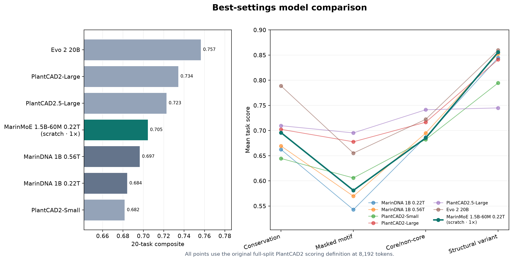
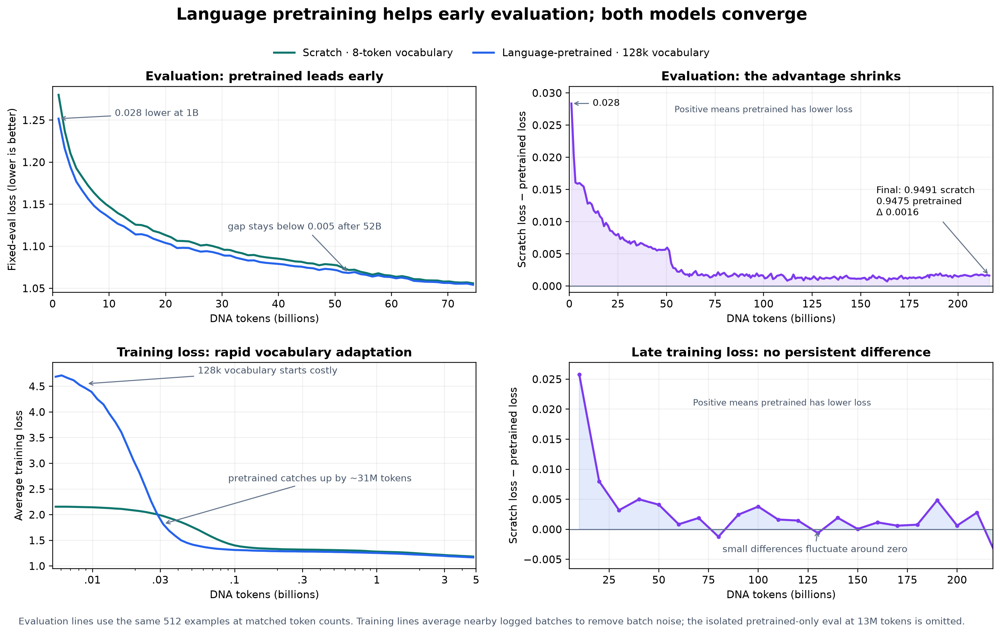
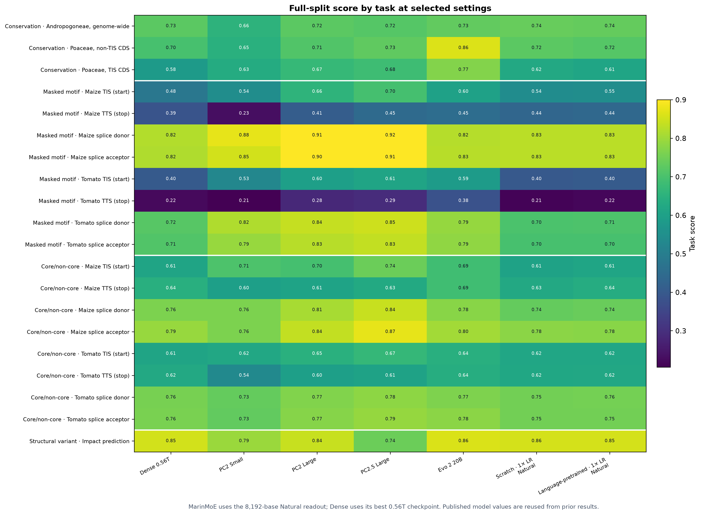
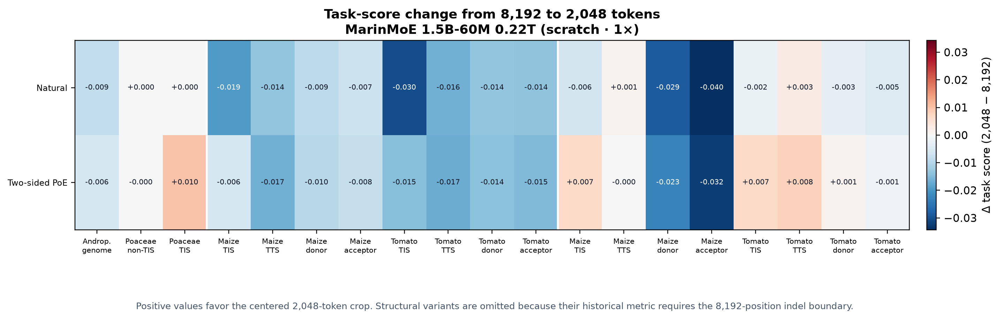
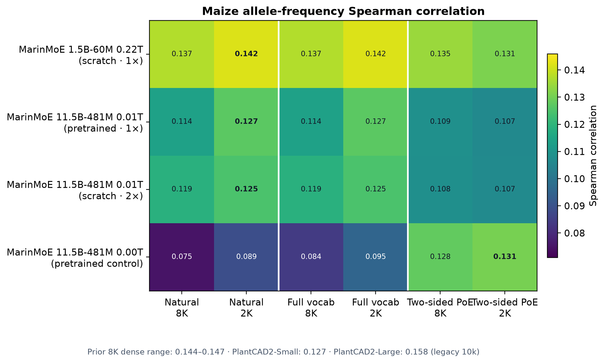
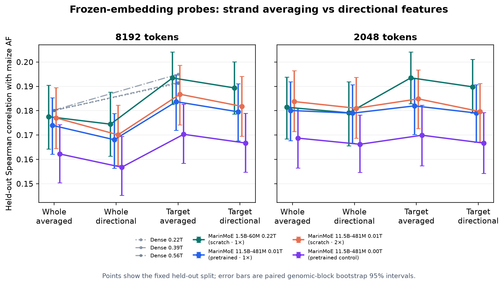
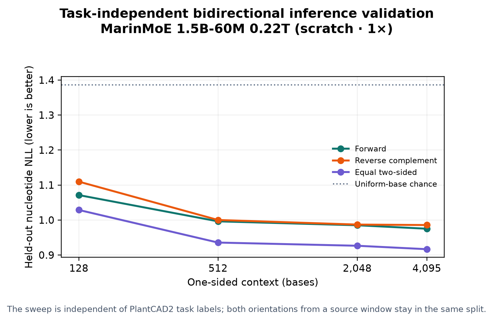

# Results — exp586 paired d768 MarinMoE models

This report compares the two requested final 1× checkpoints from [MarinDNA #586](https://github.com/Open-Athena/marin-dna/issues/586). Both saw the same 216.159B DNA bases (ten dataset epochs); every older-model value is reused from prior evaluations.

| Model | Initialization and tokenizer | Total parameters | Active parameters | DNA training | Approx. training FLOPs |
| :--- | :--- | ---: | ---: | ---: | ---: |
| MarinMoE 1.5B-60M 0.22T (scratch, 1× LR) | Random; 8-token DNA vocabulary | 1.395B | 60.555M | 216.159B tokens | 1.36×10²⁰ |
| MarinMoE 1.5B-60M 0.22T (language-pretrained, 1× LR) | d768 language checkpoint; 128,256-token vocabulary with character-forced DNA input | 1.592B | 60.555M | 216.159B tokens | 2.64×10²⁰ |

The models share the same core architecture, data, one-base-per-token input, LR heuristic, and schedule. This comparison changes both initialization and tokenizer/output head, so it is not a pure initialization ablation. The language head explains the pretrained model’s higher parameter count and roughly 1.94× analytic training FLOPs.

## Main result



At the comparable **8K Natural** readout, scratch and language-pretrained are effectively tied on the 20-task composite: **0.7045** and **0.7040**. Both improve on token-matched MarinDNA 1B 0.22T by about **+0.020**, and on the more extensively trained MarinDNA 1B 0.56T by about **+0.007**. Both exceed PlantCAD2-Small, while the larger bidirectional PlantCAD models and Evo remain ahead.

Language pretraining therefore provides no main-task gain after 0.22T DNA tokens despite its larger softmax cost. Its clearest benefit is narrower: the best zero-shot allele-frequency score rises from **0.1419** to **0.1450** Spearman. Scratch remains slightly better on the best fitted frozen probe (**0.1935** vs **0.1930**).

## Training dynamics



The first matched fixed evaluation, after 1.05B DNA tokens, favors language-pretrained by **0.0284 loss**. That advantage stays below **0.005 after 52.43B tokens** and ends at **0.9491 scratch vs 0.9475 pretrained**. The top-left panel shows the simple paired evaluation curves; the top-right plots their difference so convergence remains visible after the curves overlap.

Training batches tell a complementary story. The 128k language vocabulary makes the pretrained model much more costly initially, but it catches up within roughly 30M tokens. Later differences fluctuate around zero. The bottom panels average nearby logged batches to remove batch noise; the isolated pretrained-only evaluation at 13M tokens is omitted because the first comparable scratch evaluation is not until 1.05B tokens.

## Full task results at the comparable setting



The near-identical composites hide a small trade: scratch leads conservation by **0.0068**, while language pretraining leads core/non-core by **0.0040** and masked motifs by **0.0023**. Structural-variant scores differ by only **0.0018**. There is no broad transfer advantage from language initialization at this DNA budget.

<details>
<summary><strong>Group scores and historical comparison</strong></summary>

| Model | Conservation | Masked motif | Core/non-core | Structural variant | Composite |
| :--- | ---: | ---: | ---: | ---: | ---: |
| MarinMoE 1.5B-60M 0.22T (scratch, 1× LR) | 0.6959 | 0.5811 | 0.6853 | 0.8559 | 0.7045 |
| MarinMoE 1.5B-60M 0.22T (language-pretrained, 1× LR) | 0.6891 | 0.5834 | 0.6894 | 0.8541 | 0.7040 |
| MarinDNA 1B 0.22T | 0.6624 | 0.5428 | 0.6871 | 0.8448 | 0.6843 |
| MarinDNA 1B 0.56T | 0.6693 | 0.5696 | 0.6951 | 0.8526 | 0.6966 |
| PlantCAD2-Small | 0.6445 | 0.6059 | 0.6823 | 0.7946 | 0.6818 |
| PlantCAD2-Large | 0.7024 | 0.6777 | 0.7166 | 0.8410 | 0.7344 |
| PlantCAD2.5-Large | 0.7097 | 0.6954 | 0.7414 | 0.7450 | 0.7229 |
| Evo 2 20B | 0.7887 | 0.6552 | 0.7224 | 0.8600 | 0.7566 |

All values use the full splits and 8,192-base inputs. The composite gives each of the four task groups equal weight.

</details>

<details>
<summary><strong>All 20 task rows</strong></summary>

| Task | n | Metric | Scratch | Language-pretrained | Dense 0.56T | PC2 Small | PC2 Large | PC2.5 Large | Evo 2 20B |
| :--- | ---: | :--- | ---: | ---: | ---: | ---: | ---: | ---: | ---: |
| Conservation · Andropogoneae, genome-wide | 38,060 | AUROC | 0.7391 | 0.7369 | 0.7256 | 0.6555 | 0.7245 | 0.7170 | 0.7320 |
| Conservation · Poaceae, non-TIS CDS | 183,685 | AUROC | 0.7244 | 0.7166 | 0.6977 | 0.6462 | 0.7125 | 0.7290 | 0.8620 |
| Conservation · Poaceae, TIS CDS | 36,662 | AUROC | 0.6241 | 0.6138 | 0.5848 | 0.6319 | 0.6703 | 0.6830 | 0.7720 |
| Masked motif · Maize TIS (start) | 39,035 | Accuracy | 0.5419 | 0.5455 | 0.4805 | 0.5449 | 0.6571 | 0.6960 | 0.6020 |
| Masked motif · Maize TTS (stop) | 39,035 | Accuracy | 0.4357 | 0.4396 | 0.3857 | 0.2302 | 0.4096 | 0.4460 | 0.4530 |
| Masked motif · Maize splice donor | 153,869 | Accuracy | 0.8278 | 0.8286 | 0.8206 | 0.8754 | 0.9104 | 0.9210 | 0.8220 |
| Masked motif · Maize splice acceptor | 153,869 | Accuracy | 0.8292 | 0.8271 | 0.8162 | 0.8537 | 0.8996 | 0.9130 | 0.8260 |
| Masked motif · Tomato TIS (start) | 35,484 | Accuracy | 0.3997 | 0.4045 | 0.4027 | 0.5274 | 0.5960 | 0.6120 | 0.5860 |
| Masked motif · Tomato TTS (stop) | 35,483 | Accuracy | 0.2118 | 0.2165 | 0.2216 | 0.2051 | 0.2848 | 0.2940 | 0.3790 |
| Masked motif · Tomato splice donor | 140,456 | Accuracy | 0.7044 | 0.7068 | 0.7184 | 0.8165 | 0.8387 | 0.8460 | 0.7890 |
| Masked motif · Tomato splice acceptor | 140,455 | Accuracy | 0.6984 | 0.6988 | 0.7109 | 0.7940 | 0.8257 | 0.8350 | 0.7850 |
| Core/non-core · Maize TIS (start) | 36,409 | AUROC | 0.6068 | 0.6144 | 0.6099 | 0.7070 | 0.6960 | 0.7430 | 0.6860 |
| Core/non-core · Maize TTS (stop) | 36,409 | AUROC | 0.6251 | 0.6363 | 0.6431 | 0.5980 | 0.6080 | 0.6260 | 0.6860 |
| Core/non-core · Maize splice donor | 144,550 | AUROC | 0.7350 | 0.7408 | 0.7628 | 0.7640 | 0.8080 | 0.8420 | 0.7760 |
| Core/non-core · Maize splice acceptor | 144,550 | AUROC | 0.7790 | 0.7758 | 0.7928 | 0.7630 | 0.8360 | 0.8730 | 0.8040 |
| Core/non-core · Tomato TIS (start) | 35,478 | AUROC | 0.6159 | 0.6174 | 0.6101 | 0.6220 | 0.6460 | 0.6680 | 0.6440 |
| Core/non-core · Tomato TTS (stop) | 35,477 | AUROC | 0.6186 | 0.6216 | 0.6239 | 0.5350 | 0.5980 | 0.6060 | 0.6390 |
| Core/non-core · Tomato splice donor | 140,451 | AUROC | 0.7513 | 0.7555 | 0.7584 | 0.7350 | 0.7670 | 0.7830 | 0.7660 |
| Core/non-core · Tomato splice acceptor | 140,451 | AUROC | 0.7511 | 0.7534 | 0.7598 | 0.7340 | 0.7740 | 0.7900 | 0.7780 |
| Structural variant · Impact prediction | 18,075 | AUPRC | 0.8559 | 0.8541 | 0.8526 | 0.7946 | 0.8410 | 0.7450 | 0.8600 |

</details>

## Which inference readout worked?

| Endpoint | Selected readout | Scratch | Language-pretrained |
| :--- | :--- | ---: | ---: |
| Main 20-task suite | 8K Natural | 0.7045 composite | 0.7040 composite |
| Zero-shot maize AF | Centered 2K Natural | 0.1419 Spearman | 0.1450 Spearman |
| Fitted maize AF | Target-position, strand-averaged frozen probe at its best context | 0.1935 (2K) | 0.1930 (8K) |
| Task-independent next-base prediction | Equal two-sided PoE with 4,095 bases per side | 0.9166 NLL | 0.9124 NLL |

**Natural scoring remains the best general readout.** The centered 2K crop helps zero-shot AF but hurts the PlantCAD task suite. Two-sided PoE is the best label-free way to predict a nucleotide from both flanks, yet its loss on core/non-core classification prevents it from replacing Natural task scoring. For fitted AF, the target-position hidden state averaged across strands is consistently best.

<details>
<summary><strong>Visual guide to Natural, full-vocabulary, PoE, and frozen probes</strong></summary>

```text
ZERO-SHOT PROBABILITIES

5′ — left flank — [X] — right flank — 3′
        └────────▶ X                   forward causal view
                   X ◀────────┘        reverse-complement causal view

Natural, tasks: score the two one-sided views independently; use the established
                task-level orientation rule.
Natural, AF:    score ALT versus REF in both orientations, then average.
Full vocab, AF: same score, retaining the tokenizer's entire output denominator.
Two-sided PoE:  align the two A/C/G/T distributions, take their geometric mean,
                renormalize, then score X using evidence from both flanks.

FROZEN-EMBEDDING PROBES

REF and ALT, each in forward + reverse-complement orientation
                    │
          ┌─────────┴─────────┐
          ▼                   ▼
 mean all hidden states   hidden state at [X]
      “Whole”                 “Target”
          │                   │
          └─────────┬─────────┘
                    ▼
     average orientations  OR  concatenate orientations
         “Averaged”                 “Directional”
                    │
                    ▼
        StandardScaler → Ridge → predicted allele frequency
```

Natural, full-vocabulary, and PoE are zero-shot probability scores. The probes instead fit a small Ridge model on separate training chromosomes while keeping MarinMoE frozen.

</details>

<details>
<summary><strong>Technical readout analysis</strong></summary>

### Context length

<p align="center"></p>

The 2K crop lowers the three-group Natural composite by about 0.01 for both models. The largest losses are on tomato TIS and maize splice-site core/non-core tasks, so 8K remains the task default even though 2K is sufficient for the best AF score.

| Model | Context / method | Conservation | Masked motif | Core/non-core | 3-group composite |
| :--- | :--- | ---: | ---: | ---: | ---: |
| Scratch | 8K · Natural | 0.6959 | 0.5811 | 0.6853 | 0.6541 |
| Scratch | 8K · Two-sided PoE | 0.7154 | 0.5880 | 0.6449 | 0.6494 |
| Scratch | 2K · Natural | 0.6931 | 0.5657 | 0.6752 | 0.6446 |
| Scratch | 2K · Two-sided PoE | 0.7166 | 0.5753 | 0.6406 | 0.6442 |
| Language-pretrained | 8K · Natural | 0.6891 | 0.5834 | 0.6894 | 0.6540 |
| Language-pretrained | 8K · Two-sided PoE | 0.7092 | 0.5907 | 0.6504 | 0.6501 |
| Language-pretrained | 2K · Natural | 0.6863 | 0.5648 | 0.6783 | 0.6431 |
| Language-pretrained | 2K · Two-sided PoE | 0.7086 | 0.5732 | 0.6445 | 0.6421 |

The three-group composite excludes structural variants because their established metric has no centered two-sided definition.

### Zero-shot allele frequency

<p align="center"></p>

Centered 2K Natural is best for both models. Language pretraining gains **+0.0031** Spearman over scratch and nearly matches the historical dense 0.56T value of 0.1452. Full-vocabulary and A/C/G/T-normalized scores are numerically indistinguishable; two-sided PoE raises Pearson correlation but lowers the reported rank correlation.

### Frozen-embedding probes

<p align="center"></p>

Target-position strand averaging is best for both models. The two selected results differ by only 0.0005 and their bootstrap intervals overlap substantially; language initialization does not improve the fitted readout.

| Model / context | Whole averaged | Whole directional | Target averaged | Target directional |
| :--- | ---: | ---: | ---: | ---: |
| Scratch · 8K | 0.17755 | 0.17447 | 0.19347 | 0.18937 |
| Scratch · 2K | 0.18143 | 0.17913 | 0.19352 | 0.18981 |
| Language-pretrained · 8K | 0.16697 | 0.16230 | 0.19298 | 0.18853 |
| Language-pretrained · 2K | 0.17877 | 0.17459 | 0.19179 | 0.18728 |

Values are held-out Spearman correlations. Error bars are paired 1 Mb genomic-block bootstrap 95% intervals.

### Task-independent bidirectional check

<p align="center"></p>

Equal two-sided PoE lowers held-out nucleotide NLL at every tested context for both models without using PlantCAD task labels. It is a sound inference-time use of both flanks, but the downstream task results show that no single probability-combination rule is uniformly best.

</details>

<details>
<summary><strong>Training, execution, and verification</strong></summary>

- Architecture: 8-layer d768 latent MoE with 384 routed experts, eight selected per token, two shared experts, 384-wide latent experts, 2,048-base sliding attention, and global attention every fourth layer.
- Tokenizers: scratch uses the historical eight-entry DNA tokenizer with case normalization and a reserved EOS that is not inserted into these examples. Pretrained retains the 128,256-entry language tokenizer and applies the same character-forcing pretokenizer in training and evaluation, guaranteeing one token per nucleotide.
- Learning rate: peak MuonH 0.003320 and Adam 0.0007661 from the Hero scaling heuristic; 1% token warmup followed by linear decay to 5% of peak.
- Training: 216,158,699,520 input tokens, 412,290 updates, a global batch of 64 sequences × 8,192 tokens, and ten exact dataset epochs per model.
- FLOPs: Marin/Levanter analytic forward estimates are 209,719,296 FLOPs/token scratch and 406,708,224 pretrained. The 3× forward-plus-backward convention gives 1.36×10²⁰ and 2.64×10²⁰ training FLOPs; communication, optimizer bookkeeping, and rematerialization are excluded.
- Evaluation: all 20 original tasks at 8K, the 19 centered tasks at 2K, and 94,075 AF variants at each context. Frozen probes use train-only grouped cross-validation and a fixed held-out split.
- Verification: checkpoint/tokenizer identities, exact batching, finite nonconstant outputs, repeat and context oracles, planned shards, receipts, and NPZ hashes were checked directly against CoreWeave S3. The new pretrained evaluation verified all 4,655 worker NPZs (3.55 GB) and all 19 postprocessed files (674.6 MB).
- Backend: ring EP trained scratch; fixed pooled-wave EP trained pretrained. Evaluation used dropless Sonic only after independent real-genome parity checks against each training backend.
- Final checkpoints: update 412,290; canonical digests scratch `737fa99f…72d9`, pretrained `275e68e8…4a89`.
- Scratch: [training](https://forge.coreweave.com/wandb/eric-czech/marin/runs/exp586-plantcad2-d768-scratch-lrm1-seed0-v1) · [postprocess](https://forge.coreweave.com/wandb/eric-czech/marin/runs/exp586-plantcad2-d768-scratch-lrm1-seed0-final-eval-postprocess-v1)
- Language-pretrained: [training](https://forge.coreweave.com/wandb/eric-czech/marin/runs/exp586-plantcad2-d768-pretrained-lrm1-seed0-v1) · [postprocess](https://forge.coreweave.com/wandb/eric-czech/marin/runs/exp586-plantcad2-d768-pretrained-lrm1-seed0-final-eval-postprocess-v1)

</details>
